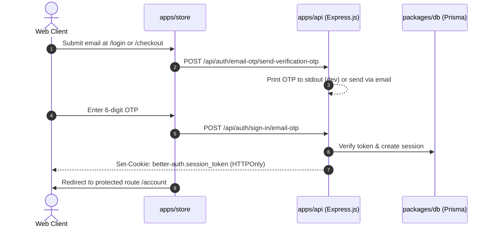
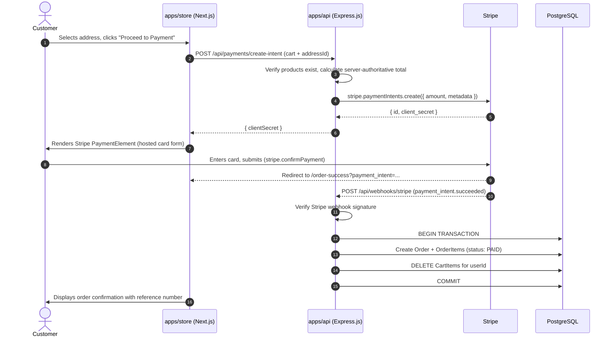

# System Architecture Guide

This document describes the design patterns, package configurations, and network data flows powering the Caguei monorepo e-commerce architecture.

---

## Workspace Layout

We use **pnpm workspaces** to orchestrate dependencies, caching, and builds across project services:

```text
caguei-ecommerce/
  apps/
    store/ (Next.js Storefront - customer-facing)
    admin/ (Next.js Admin Panel - administrative controls)
    api/ (Express.js Backend - centralized API & Auth server)
  packages/
    db/ (Shared Prisma database ORM wrapper)
  docs/
    api-reference.md
    architecture.md
    design-system.md
    getting-started.md
```

---

## Data Flow — Authentication



---

## Data Flow — Stripe Checkout (Secure Payment Confirmation)

This is the key security pattern. **The order is never created from client data.** Stripe's webhook is the authoritative source of truth.



---

## Technical Component Details

### 1. Central API Backend (`apps/api`)
- Built on **Express.js** and TypeScript, running on port `4000`.
- Organized into domain-based modules under `src/modules/` (`users`, `addresses`, `cart`, `wishlist`, `payments`, `products`, `orders`, `webhooks`).
- Enforces a 3-layer architecture (`.routes.ts`, `.controller.ts`, `.service.ts`) for clean separation of concerns.
- Reusable `requireAuth` Express middleware (`src/middleware/auth.middleware.ts`) validates BetterAuth sessions and attaches `req.user` & `req.session`.
- CORS configured to trust `localhost:3000` (store) and `localhost:3001` (admin) with cookie credentials.
- **Stripe webhook** endpoint uses `express.raw()` middleware registered before `express.json()` for signature verification.
- Order creation is DB-first (PENDING status created before PaymentIntent confirmation, updated to PAID by webhook).

### 2. Stripe Security Model
- The client receives only a `clientSecret` to initialize the Stripe PaymentElement.
- All pricing is **recalculated server-side** when creating the PaymentIntent by verifying product prices from the DB.
- The webhook verifies the Stripe signature using `STRIPE_WEBHOOK_SECRET` before trusting any event.
- Webhook handlers are **idempotent** — replayed events are ignored if the order already exists.

### 3. Shared Database Adapter (`packages/db`)
- Defines all relational data models in `prisma/schema.prisma`:
  - Auth: `User`, `Session`, `Account`, `Verification`
  - Commerce: `Address`, `Product`, `CartItem`, `WishlistItem`, `Order`, `OrderItem`
- `Order.stripePaymentIntentId` is stored as a unique field enabling idempotent webhook processing.

### 4. Storefront State Management (`apps/store/lib/context/store-context.tsx`)
- Uses `useSession()` hook to detect authentication status.
- On login: merges guest `localStorage` cart/wishlist into the DB, then loads DB state.
- All mutations (`addToCart`, `removeFromCart`, etc.) optimistically update local state and asynchronously sync to the DB.
- On logout: falls back to `localStorage`.

### 5. Server Component Route Protection
- `app/(main)/layout.tsx` calls `auth.api.getSession()` server-side.
- Unauthenticated users are redirected to `/login` before any page HTML renders.

---

## Environment Variables

| App | Variable | Description |
|-----|----------|-------------|
| `api` | `DATABASE_URL` | PostgreSQL connection string |
| `api` | `BETTER_AUTH_SECRET` | BetterAuth signing secret |
| `api` | `BETTER_AUTH_URL` | API server base URL |
| `api` | `STRIPE_SECRET_KEY` | Stripe secret key (`sk_test_...`) |
| `api` | `STRIPE_WEBHOOK_SECRET` | Stripe webhook signing secret (`whsec_...`) |
| `store` | `NEXT_PUBLIC_API_URL` | API base URL for client-side fetches |
| `store` | `NEXT_PUBLIC_STRIPE_PUBLISHABLE_KEY` | Stripe publishable key (`pk_test_...`) |
