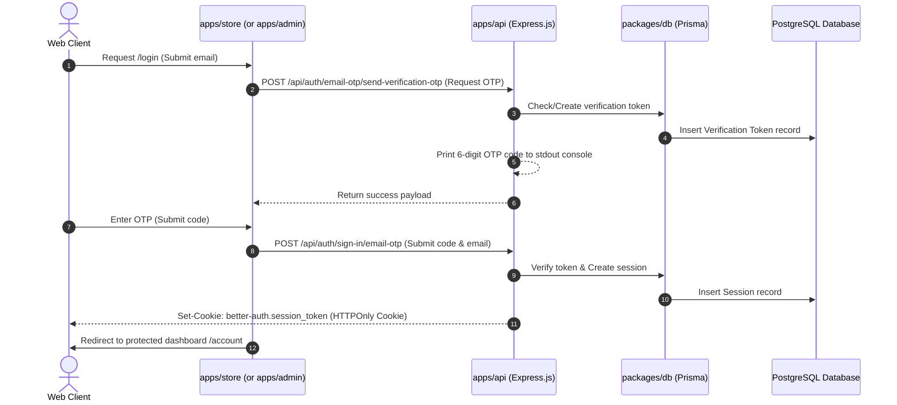

# System Architecture Guide

This document describes the design patterns, package configurations, and network data flows powering the Caguei monorepo e-commerce architecture.

---

## Workspace Layout

We use **pnpm workspaces** and **Turborepo** to orchestrate dependencies, caching, and builds across our project services:

```text
caguei-ecommerce/
  apps/
    store/ (Next.js Storefront - customer-facing)
    admin/ (Next.js Admin Panel - administrative controls)
    api/ (Express.js Backend - centralized API & Auth server)
  packages/
    db/ (Shared Prisma database ORM wrapper)
    ui/ (Shared frontend components)
    eslint-config/
    typescript-config/
```

---

## Architectural Data Flow



---

## Technical Component Details

### 1. Central API Backend (`apps/api`)
- Built on **Express.js** and TypeScript.
- Runs on port `4000` (`http://localhost:4000`).
- Configures CORS options to trust and exchange credentials (cookies) with local frontend origins:
  - Storefront Origin: `http://localhost:3000`
  - Admin Portal Origin: `http://localhost:3001`
- Exposes a catch-all route mapping BetterAuth handlers:
  ```typescript
  app.all('/api/auth/*', toNodeHandler(auth));
  ```

### 2. Shared Database Adapter (`packages/db`)
- Defines the core relational data models (`User`, `Session`, `Account`, `Verification`) in a single `prisma/schema.prisma` file.
- Imports the **pg** pool client and **PrismaPg** driver adapter. Because Prisma 7 deprecates native client binaries, all database connections compile as typed WebAssembly client instances.
- Instantiates a global singleton database client exported as `prisma`.

### 3. Server Component Route Protection
- Next.js App Router folders use route grouping `(main)` to enforce server-side layout authentication gates.
- In `app/(main)/layout.tsx`, the component extracts incoming headers and requests verification checks directly from the database:
  ```typescript
  const session = await auth.api.getSession({
    headers: await headers()
  });

  if (!session) {
    redirect('/login');
  }
  ```
  This server-side redirect prevents page flashing and secures private HTML rendering.
